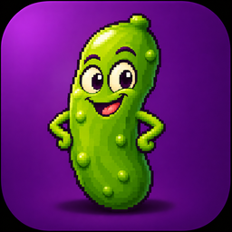

# PixelPickle



Fotobewerker voor Linux met een begrijpelijke en vertrouwde indeling van de gereedschappen. Menu's,
gereedschappen en sneltoetsen staan op vaste, logische plekken, zodat je direct aan de slag kunt en
niet hoeft te zoeken.

## Wat het kan

**Werkruimte**
- Menubalk, standaardwerkbalk en een gereedschapsbalk met uitklapgroepen.
- Optiebalk met de instellingen van het gekozen gereedschap: bij elk gereedschap even hoog en strak
  uitgelijnd, met eigen voorinstellingen per gereedschap. Elk invoerveld heeft een schuifbalk om snel
  grote stappen te maken.
- Paletten Materialen, Lagen, Geschiedenis, Histogram, Overzicht en Penseelvariantie, los te maken en vrij
  te plaatsen; werkbalken Standaard, Gereedschappen, Effecten en Foto.
- Linialen, hulplijnen (sleep ze uit de linialen), raster en uitlijnen op raster of hulplijnen; Vergrootglas
  en schermvullend voorbeeld.
- Meerdere afbeeldingen tegelijk, als tabbladen of als losse vensters.
- Snelmenu's met de rechtermuisknop op de afbeelding, het lege werkvlak, de tabbladen, de lagen, de Pen en
  vectorobjecten.
- Strakke lijniconen in de accentkleur van je eigen thema; ziet er goed uit op licht en donker.
- Schuifbalken rond grote afbeeldingen; ruitjespatroon en arcering instelbaar in de voorkeuren.
- In negen talen: Engels, Nederlands, Duits, Frans, Spaans, Italiaans, Russisch, Chinees en Arabisch.

**Gereedschappen**
- Pannen en zoomen, selecteren en verplaatsen.
- Selecties: rechthoek, ovaal en andere vormen, uit de vrije hand (ook punt tot punt en Slimme rand)
  en de toverstaf met overeenkomstmodi en tolerantie. Het menu Selecties heeft alles om een selectie bij te
  werken: kleurbereik, dezelfde kleur, doezelen naar binnen of buiten, anti-alias, stippen en gaten
  verwijderen, selectieranden, zwevend, opslaan in alfakanalen of op schijf, en Selectie bewerken (schilder
  de selectie zelf, met een rode laag voor wat niet geselecteerd is). Bij puntsgewijs selecteren schuift het beeld
  vanzelf mee als je bij de rand van het venster komt. Met de pijltoetsen schuif je een selectie per pixel
  (Shift: 10 pixels, Ctrl: alleen het kader); houd je de toets vast, dan gaat het steeds sneller.
- Bijsnijden met een aanpasbaar kader: grepen op hoeken en zijden, vaste verhoudingen, maten in te
  typen en uitlijnen op laag of afbeelding. Dubbelklik in het kader om bij te snijden.
- Rechtzetten, perspectiefcorrectie, rode ogen verwijderen, klonen en krasjes verwijderen.
- Makeover voor portretten (vlekken verwijderen, tanden witter, oogwit helderder, zonnebruin, slanker
  maken) en Object verwijderen: trek een lijn om iets, kies een bron en het verdwijnt naadloos.
- Penseel, airbrush, wisser, vlakvulling en kleurwisselaar; eigen penselen te maken uit een selectie of
  een afbeelding, en penseelvariantie voor een natuurlijke streek.
- Retoucheerpenselen: lichter/donkerder, tegenhouden, doordrukken, vegen, duwen, verzachten,
  verscherpen, reliëf, verzadiging, tint en meer.
- Kunstmedia: olieverfpenseel, paletmes, krijt, pastel, kleurkrijt, kleurpotlood en markering, elk met een
  eigen streek.
- Verwringen met een penseel (duwen, uitzetten, samentrekken, draaien, gladstrijken) en met een raster.
- Pen met rechte lijnen, Bézier-krommen en vrije lijnen; knooppunten selecteren, verbinden, samenvoegen,
  onderbreken, knooppunttypen en transformeren.
- Vormen (rechthoek, ovaal, symmetrische vormen, basisvormen en eigen vormen).
- Bewerkbare tekst met opmaak per woord, verloop of patroon in de letters, tekst langs een pad en tekst
  omzetten in curven.
- Menu Objecten voor vectorobjecten: kiezen, uitlijnen, verdelen, even groot maken, schikken, groeperen
  en eigenschappen.

**Materialen**
- Kleur, verloop (lineair, rechthoekig, zonnestraal, radiaal; met hoek, herhalingen en middelpunt) en
  patroon (met hoek en schaal; ook een geopende afbeelding of een eigen bestand).
- Werkt met de vulemmer, de penselen, de vormen en tekst; eigen verlopen maken met de verloopbewerker.
- 45 verlopen en 43 patronen meegeleverd: van metaal, neon en landschappen tot hout, marmer,
  stoffen en dierenprints.

**Lagen**
- 21 mengmodi, dekking, lagengroepen, maskerlagen, aanpassingslagen en vectorlagen.
- Vectorlagen: lijnen en vormen blijven bewerkbaar zolang je met de afbeelding bezig bent (en in .ora).
- Mengbereiken: bepaal per kanaal waar een laag zichtbaar is, op basis van de laag zelf en van wat
  eronder ligt.
- Koppelingssets, transparantie vergrendelen en lagen markeren met een kleur; snel lagen tonen of verbergen
  via Lagen > Beeld.

**Aanpassen en effecten**
- 142 aanpassingen en effecten met een Vóór/Na voorbeeld waarin je kunt zoomen en schuiven, een
  voorbeeld op de afbeelding zelf en voorinstellingen.
- Effecten zoeken met voorbeelden naast elkaar, en snelle fotocorrecties via Foto verbeteren.
- Afbeelding: kleurdiepte verminderen, kanalen splitsen en combineren (RGB, HSL, CMYK), berekeningen
  tussen twee afbeeldingen en fotolijsten.

**Bestanden en veiligheid**
- Openen en opslaan: PNG, JPEG, TIFF, BMP, WebP, GIF (ook transparant, via GIF-optimalisatie),
  OpenRaster (.ora, de open standaard waarin lagen en vectoren bewaard blijven) en .pspimage
  (openen van bestaande bestanden, en opslaan als extra keuze).
- PNG-optimalisatie, afbeelding met hyperlinks (HTML), afdrukken met voorbeeld en schermopname.
- Batchverwerking (omzetten en verkleinen) en namen in batch wijzigen.
- Ongedaan maken en opnieuw, met alle stappen in het palet Geschiedenis; naar de vorige versie terug.
- Automatisch opslaan naar een herstelmap, op een instelbaar interval.

**Hulp**
- Uitgebreide gebruikershandleiding in negen talen, met een hoofdstuk per gereedschap, elke menu-opdracht
  en elk effect met al zijn instellingen, plus een overzicht van alle sneltoetsen (menu Help).

## Installeren

Download het pakket voor jouw distributie bij de nieuwste
[release](https://github.com/rene-timmermans/PixelPickle/releases/latest). Alles wat PixelPickle nodig
heeft, installeert je pakketbeheerder automatisch mee. Daarna staat PixelPickle in het menu (Grafisch)
of start je het met `pixelpickle`.

| Distributie | Installeren | Verwijderen |
|---|---|---|
| Arch, SteamOS, Manjaro, EndeavourOS | `sudo pacman -U pixelpickle-<versie>-1-any.pkg.tar.zst` | `sudo pacman -R pixelpickle` |
| Debian 13 of nieuwer, recente Ubuntu | `sudo apt install ./pixelpickle_<versie>-1_all.deb` | `sudo apt remove pixelpickle` |
| Fedora | `sudo dnf install ./pixelpickle-<versie>-1.*.noarch.rpm` | `sudo dnf remove pixelpickle` |

Elk pakket wordt bij een release automatisch gebouwd, geïnstalleerd en getest op die distributie.
Ubuntu 24.04 en Debian 12 worden niet ondersteund.

## Taal

PixelPickle is er in het Engels, Nederlands, Duits, Frans, Spaans, Italiaans, Russisch, Chinees en
Arabisch (van rechts naar links). Bij de eerste start is de taal Engels. Kies een andere taal via
**File > Preferences > General Program Preferences**; de gebruikershandleiding is er in elke taal.

## Wat er nieuw is

**1.3.0** Aanpassingen en effecten werken op lagengroepen: is een groep de actieve laag, dan wordt elke rasterlaag
erin bewerkt en toont het voorbeeldvenster de hele groep. Kies je in het lagenpalet een andere laag, dan staat het
kader van het gereedschap Selecteren meteen om die laag.

**1.2.0** Het gereedschap Selecteren werkt op lagengroepen: verplaatsen, schalen en roteren doen de hele groep
als één geheel. Uitlijnen, Verdelen en Even groot maken werken ook op de lagen in een groep. Klik je met Selecteren
op iets van een andere laag, dan wordt die laag meteen actief en kun je haar direct slepen.

**1.1.0** Met Ctrl ingedrukt kies je bij het penseel, Kleur vervangen en Naar doel overgaan meteen een kleur met
de pipet. Spiegelen zonder selectie spiegelt een laag op haar eigen plek. Naar doel overgaan wordt niet sterker als
je twee keer over dezelfde plek gaat. Selecties van 1 pixel breed of hoog lukken nu altijd. Verder een schuifbalk
bij de laagdekking, smallere tabbladen boven de kleurkiezer en de augurk in het infovenster.

**1.0.4** De rechterkolom met Materialen en Lagen is nu veel smaller te slepen.

**1.0.3** De kleurvakken in het materialenpalet zijn precies uitgelijnd met het kleurenspectrum ernaast.

**1.0.2** Strakker materialenpalet: de knopjes onder de kleurvakken staan tegen elkaar aan en het palet kan
smaller.

**1.0.1** De sneltoetsen voor de gereedschappen werken weer, evenals Ctrl+F4 en Ctrl+W. Algemene
programmavoorkeuren heeft nu ook Transparantie en arcering (het ruitjespatroon achter doorzichtige delen en
de arcering bij bijsnijden) en Lettertypen, waarmee je de Microsoft-kernlettertypen met één klik downloadt
en installeert. Rond een grote afbeelding staan schuifbalken.

**1.0.0** Compleet: alle gereedschappen en menu-opdrachten zijn er. Nieuw in deze versie zijn onder meer
tekst met opmaak per woord, verloop en patroon in tekst, tekst langs een pad en tekst in curven; het menu
Objecten voor vectorobjecten; uitgebreide pen-bewerkingen; alfakanalen; het hele menu Selecties (onder meer
kleurbereik, zwevend en Selectie bewerken); linialen, hulplijnen en uitlijnen; de paletten Histogram,
Overzicht en Penseelvariantie; de werkbalken Effecten en Foto; kleurdiepte verminderen, kanalen splitsen en
combineren, berekeningen en fotolijsten; eigen penselen, vormen, lijsten en verlopen; afdrukken,
schermopname, batchverwerking en snelmenu's zoals je ze gewend bent.

**0.10.0** Alle gereedschappen zijn er: Makeover (vlekken verwijderen, tanden witter, oogwit helderder,
zonnebruin en slanker maken), Object verwijderen, Markering en Paletmes. De Kleurwisselaar verandert alle
gelijkende kleuren met behoud van schaduw. Invoervelden in de optiebalk hebben een schuifbalk, pijltoetsen
versnellen als je ze vasthoudt, spiegelen met een selectie gebeurt op dezelfde plek en Penseel Verwringen
loopt vloeiend af naar de rand.

**0.9.0** Negen talen (Engels, Nederlands, Duits, Frans, Spaans, Italiaans, Russisch, Chinees, Arabisch) en een
uitgebreide handleiding met elk gereedschap, menu en effect. Selecties verschuiven met de pijltoetsen,
broncirkel bij klonen, .ora als standaardformaat en verbeterde vervaag- en korreleffecten.

**0.8.0** Vernieuwde optiebalk: bij elk gereedschap even hoog en strak uitgelijnd, met een groot icoon
vooraan in plaats van de naam, kleinere vinkjes in dezelfde letter als de labels, en een smallere balk.

**0.7.0** Vectorlagen: lijnen van de pen en vormen blijven bewerkbaar zolang je met de afbeelding bezig
bent. Pak ze later weer op met de pen in de modus Bewerken om knooppunten, kleur en lijn aan te passen.

**0.6.1** De pen is vernieuwd: lijnen en polylijnen, punt tot punt met Bézier-krommen, uit de vrije hand
en bewerken van knooppunten, met lijnstijl, verbinding en verstek. De lijn blijft bewerkbaar tot Toepassen.

**0.6.0** Negen nieuwe gereedschappen: perspectiefcorrectie, krasjes verwijderen, penseel verwringen,
maasvormig verwringen en de kunstmedia olieverfpenseel, krijt, pastel, kleurkrijt en kleurpotlood.
Retoucheerpenselen zoals verscherpen en bosseleren werken nu één keer per streek, met de optie Doorlopend
om het effect op te bouwen.

**0.5.5** Het beeld schuift alleen nog mee bij de rand tijdens puntsgewijs selecteren, niet meer bij
penselen en andere gereedschappen. Opgeloste glitch in het kleurenpalet en een vinkje bij Opties voor
gereedschap.

**0.5.4** Een stuk uit een selectie halen of eraan toevoegen met de modus Verwijderen of Toevoegen werkt nu
ook als je binnen de bestaande selectie klikt.

**0.5.3** 45 verlopen en 43 patronen, direct in het programma.

**0.5.2** Nieuwe omschrijving van het programma in de pakketten en het menu.

**0.5.1** Het effectvenster meldt het wanneer er een selectie actief is, zodat duidelijk is waarom het
voorbeeld alleen dat gebied toont.

**0.5.0** Vooral cosmetisch: eigen lijniconen in de accentkleur van het thema voor alle werkbalken,
paletten en muisaanwijzers, en een strak uitgelijnde optiebalk. Nieuw: mengbereiken in
Laageigenschappen.

**0.4.0** Bijsnijden met een aanpasbaar kader, verloop en patroon als materiaal, automatisch opslaan,
gebruikershandleiding en een nieuw venster Info. Zonder geopende afbeelding is geen gereedschap actief;
daarna komt het laatst gebruikte gereedschap terug.

**0.3** Engels als tweede taal, pakketten voor Debian, Ubuntu en Fedora, een eigen programma-icoon,
zoomen en schuiven in het effectvoorbeeld en automatisch meeschuiven bij de rand tijdens het selecteren.

**0.2** Eigen muisaanwijzer per gereedschap; vrije software onder de GPL.

**0.1** Eerste versie: menu's, gereedschappen, lagen en effecten.

## Ontwikkelen

```
./pixelpickle.sh                                           # starten vanuit de broncode
QT_QPA_PLATFORM=offscreen .venv/bin/python tests/smoke.py   # tests
```

Functies die nog niet gebouwd zijn, staan in [TODO.md](TODO.md).

## Licentie

PixelPickle is vrije software onder de [GNU General Public License v3.0 of later](LICENSE).
